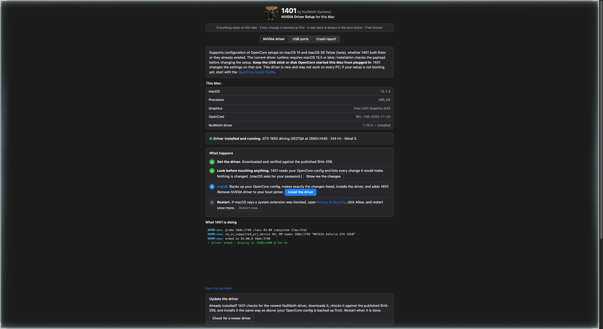

<div align="center">

# greenlight

**NVIDIA on macOS, automated — one CLI that takes an OpenCore Hackintosh from "the driver never loads" to a verified NullMoth stack.**

Validated on real hardware first: a GTX 1650 Mobile (Turing, TU117M) driving 2560×1440 @ 144 Hz over HDMI with Metal 3, on macOS 15 Sequoia.

[](https://github.com/joseteo/nvidia-macos-opencore/actions/workflows/ci.yml)

-76B900?logo=nvidia&style=for-the-badge)


</div>

---

## What it does

`greenlight` is a Rust CLI that automates the NVIDIA-on-OpenCore setup this repo first did by hand:

- **`greenlight doctor`** — probes the hardware, locates the OpenCore config that actually boots the machine, scans it for the known NVIDIA-killing leftovers, and reports exactly what needs changing. Read-only — it never writes anything.
- **`greenlight fix`** — applies the validated config set (timestamped backup before any write, plan shown first, confirmation required), installs AMFIPass.kext plus the NullMothSafe.efi picker recovery entry (when the official 1401 DMG fetches and verifies — otherwise the printed OpenShell steps are the recovery path), then downloads the latest NullMoth driver from the official release, verifies every file against the release's published SHA-256 sums, and runs its installer.
- **`greenlight fix --check`** — post-reboot verification: NullMoth kexts loaded, NVIDIA card claimed, resolution / refresh / Metal level per display — the proof table below, printed live.

Everything the tool does was validated manually on the reference laptop and written up in
[docs/INSTALL-GUIDE.md](docs/INSTALL-GUIDE.md) — the guide is the spec the automation encodes.

## Quickstart

Requires the [Rust toolchain](https://rustup.rs) (`cargo`) and macOS. Run on the Hackintosh itself.

```bash
git clone https://github.com/joseteo/nvidia-macos-opencore.git
cd nvidia-macos-opencore
cargo build --release

sudo ./target/release/greenlight doctor      # what's my state? (read-only)
sudo ./target/release/greenlight fix         # apply the validated setup
# reboot, then:
./target/release/greenlight fix --check      # verify the live driver stack
```

`fix` never writes blind: it prints the full plan, asks before applying, backs up the config with a timestamp, and every run that writes ends with the exact recovery steps (OpenShell + firmware boot menu). `--dry-run` shows the plan and commands without touching anything.

The automation gate is a validated-profile match: `fix` applies automatically on the validated hardware class (Intel laptop + NVIDIA Turing dGPU). Other hardware gets an honest report and no changes unless you explicitly pass `--force`.

## Proof

The first documented **Turing laptop** running the [NullMoth NVIDIA driver](https://github.com/nullmoth/nvidia-macos-driver)
(upstream lists Turing as *validation pending* — this repo is the real-hardware evidence it works, plus exactly what it took):

| | |
|---|---|
| External display | **2560×1440 @ 144 Hz over HDMI** (Gigabyte GS27QA), driven by the GTX 1650, Main Display |
| GPU in macOS | `NVIDIA GeForce GTX 1650`, 4 GB, PCIe x16, **Metal 3** |
| Kernel | all four `com.nullmoth.*` kexts loaded; `probe 10de:1f99 → rm_is_supported_pci_device OK → armed on 01:00.0` |
| Setup | macOS 15.7.4 (24G517), OpenCore 1.0.6, SMBIOS MacBookPro16,4, SIP `0x0A43` |

Full logs, exact config delta and verification commands: **[docs/INSTALL-GUIDE.md](docs/INSTALL-GUIDE.md)**.
Reported upstream as [issue #104](https://github.com/nullmoth/nvidia-macos-driver/issues/104).

## The one fix that made it work

> The OpenCore config carried a dortania-era dGPU-kill leftover:
> `DeviceProperties → PciRoot(0x0)/Pci(0x1,0x0)/Pci(0x0,0x0) → class-code <FFFFFFFF>, disable-gpu <01>`.
> The faked class-code silently defeats NVRM's PCI match — **every kext installed correctly and the driver
> simply never loads. No error, anywhere.** Deleting that entry was the entire fix.
> If you ever followed a "disable the dGPU" guide on an Optimus laptop, check this first.

`greenlight doctor` detects exactly this class of leftover (`class-code`, `disable-gpu`, `nv_disable=1`, `agdpmod=pikera`) — it's the first thing the scan looks for.

## Caveats

- **BAR1 / first boot.** On laptops whose BAR1 can't be placed, the first boot after fixing may leave the display dark. v1 has no live BAR1-placement detector, so it never adds `nvrmsettle=10000` for you — if the display doesn't come up, add `nvrmsettle=10000` to boot-args manually (guide §3). If your config already carries an `nvrmsettle` value, greenlight never removes it.
- **Windows dual-boot.** Boot Windows via the firmware boot menu (F12), not the OpenCore picker — `ResizeGpuBars` applies hardware-wide before any OS starts, and Windows through the picker blue-screens. See [INSTALL-GUIDE §7](docs/INSTALL-GUIDE.md#7-windows-dual-boot-warning-blue-screen-already-happened-once).
- **Internal panel** stays on the Intel iGPU (Optimus wiring — the dGPU drives only the external outputs).
- **macOS updates:** remove the driver first, re-apply after (guide §5–6).

## Roadmap

- **v1 (this repo):** `doctor`, `fix`, `fix --check` — done.
- **v2 (next):** `forge` — generate a complete, installer-safe OpenCore EFI for the detected hardware. See [docs/PLAN-2-FORGE.md](docs/PLAN-2-FORGE.md).

## 1401 app — Apple-native redesign proposal

A **CSS-only** reskin (`guide.css` + `app.css`, zero markup/JS changes) that takes the 1401 setup app from its
retro theme to a modern macOS-native look — grouped cards, segmented control, step progress circles, light + dark mode.



→ [`1401-redesign/REDESIGN.md`](1401-redesign/REDESIGN.md) · open `1401-redesign/preview/index.html` to see it live.
Destined for an upstream PR, not a fork.

## Docs

- [docs/INSTALL-GUIDE.md](docs/INSTALL-GUIDE.md) — full install log, config delta, recovery playbook, from-scratch replication
- [docs/TRACKPAD-BLUETOOTH-SETUP.md](docs/TRACKPAD-BLUETOOTH-SETUP.md) — I2C trackpad + Intel Bluetooth on the IdeaPad Gaming 3: from-scratch recipe and debugging record
- [docs/UPSTREAM-ISSUE.md](docs/UPSTREAM-ISSUE.md) — the hardware report filed upstream ([#104](https://github.com/nullmoth/nvidia-macos-driver/issues/104))
- [docs/PLAN-2-FORGE.md](docs/PLAN-2-FORGE.md) — what's next: `forge` (OpenCore EFI generation)
- [1401-redesign/](1401-redesign/) — the app redesign

I re-validate on every NullMoth release and keep the guide current — watch the repo if you have a Turing laptop.

## License & credits

All code and documentation in this repo is ours and **MIT** (see [LICENSE](LICENSE)) — © 2026 José Teo Lorente ([@joseteo](https://github.com/joseteo)).
The NullMoth driver itself is **never hosted or mirrored here**: `greenlight` fetches it at runtime from
[NullMoth's official releases](https://github.com/nullmoth/nvidia-macos-driver/releases) and hash-verifies it.
The driver's own license — [PolyForm Noncommercial 1.0.0](https://github.com/nullmoth/nvidia-macos-driver) (core) / LGPL-3.0 / MIT (parts) — applies to it: **noncommercial use only**. NVIDIA GSP firmware © NVIDIA.

- NullMoth NVIDIA driver & the 1401 setup app: © NullMoth Systems. Not affiliated with or endorsed by NullMoth Systems; "NullMoth" and "1401" are their trademarks.
- OpenCore, Lilu, WhateverGreen, AppleALC, AMFIPass: their respective authors — and [dortania](https://dortania.github.io/) for the guide ecosystem that got every one of us this far.

## Support

This project is free and always will be. If it saved you a weekend:

<a href="https://paypal.me/joseteolorente"></a>

And support the people who wrote the actual driver: [buymeacoffee.com/nullmoth](https://buymeacoffee.com/nullmoth).

## Dev

```bash
cargo test                              # full suite — offline, unprivileged
cargo clippy --all-targets -- -D warnings
```

The test suite runs fully offline and unprivileged through three fixture seams — environment variables that swap live system access for recorded fixtures:

- `GREENLIGHT_FIXTURE_HARDWARE=<file>` — `doctor`/`fix` read a recorded hardware dump (schema: `tests/fixtures/hardware-lenovo.json`) instead of probing the machine.
- `GREENLIGHT_FIXTURE_HTTP=<dir>` — release downloads come from a directory of canned responses instead of the GitHub API.
- `GREENLIGHT_FIXTURE_SHELL_DIR=<dir>` — `fix --check` reads canned `kextstat` / `system_profiler` output.

**Never set these for a real run.** They exist so the suite can exercise every flow without network, root, or NVIDIA hardware.
